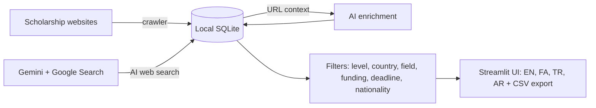

<div dir="rtl" lang="fa">

<div align="center">


<br />

# 🎓 ایجنت بورسیه تحصیلی دارا

**ابزار رایگان و متن‌باز برای جستجو، فیلتر و مقایسه بورسیه‌های تحصیلی سراسر جهان بر اساس مقطع، کشور مقصد، رشته، نوع تأمین مالی و ملیت شما.**

قدرت‌گرفته از **Google Gemini** · ساخته‌شده با **Python و Streamlit** · رابط کاربری به **English · فارسی · Türkçe · العربية**


[امکانات](#features) · [شروع سریع](#quick-start) · [نحوه استفاده](#usage) · [استقرار آنلاین](#deploy) · [رفع مشکلات](#troubleshooting)

🌐 [English](README.md) · **فارسی** · [Türkçe](README.tr.md)

</div>

---

<details open>
<summary><b>📑 فهرست مطالب</b></summary>

- [📖 معرفی ایجنت بورسیه تحصیلی دارا](#what-is)
- [✨ امکانات](#features)
- [🧠 نحوه عملکرد](#how-it-works)
- [🚀 شروع سریع](#quick-start)
  - [🔑 دریافت کلید رایگان Gemini API](#api-key)
  - [⚙️ پیکربندی](#configuration)
- [🧭 نحوه استفاده](#usage)
- [🌐 منابع پشتیبانی‌شده](#sources)
- [🗂️ ساختار پروژه](#project-structure)
- [🖼️ تصاویر کشورها](#country-images)
- [☁️ استقرار آنلاین](#deploy)
- [🛠️ رفع مشکلات رایج](#troubleshooting)
- [⚠️ استفاده مسئولانه و سلب مسئولیت](#responsible-use)
- [🗺️ نقشه راه](#roadmap)
- [🤝 مشارکت در توسعه](#contributing)
- [📄 مجوز](#license)
- [👤 سازنده و پشتیبانی](#author)

</details>

---

<a id="what-is"></a>

## 📖 معرفی ایجنت بورسیه تحصیلی دارا

پیدا کردن یک **بورسیه تحصیلی با تأمین مالی کامل** معمولاً به بررسی ده‌ها وب‌سایت با ساختار، مهلت و شرایط پذیرش متفاوت نیاز دارد. **ایجنت بورسیه تحصیلی دارا** یک **موتور جستجوی بورسیه و ایجنت هوش مصنوعی** است که این کار را برای شما ساده می‌کند:

1. **صدها بورسیه را در چند ثانیه** از وب‌سایت‌های شناخته‌شده دریافت می‌کند (بدون نیاز به هوش مصنوعی یا کلید API).
2. با **Gemini و جستجوی گوگل** وب را جستجو می‌کند و بورسیه‌هایی را می‌یابد که در آن منابع فهرست نشده‌اند.
3. با کمک هوش مصنوعی **صفحه هر بورسیه** را می‌خواند و اطلاعات تأمین مالی، ملیت‌های واجد شرایط، رشته‌ها و الزامات زبان را تکمیل می‌کند.
4. امکان **فیلتر فوری نتایج** بر اساس مقطع، کشور، رشته، نوع تأمین مالی، مهلت درخواست و **ملیت شما** را فراهم می‌کند؛ همه نتایج به‌صورت محلی روی رایانه شما ذخیره می‌شوند.

این ابزار برای متقاضیان بورسیه **کارشناسی، کارشناسی ارشد، دکتری و پسادکتری** در خارج از کشور و نیز مشاوران تحصیل در خارج که به تهیه سریع و تکرارپذیر فهرست بورسیه‌ها نیاز دارند، طراحی شده است.

<a id="features"></a>

## ✨ امکانات

- 🎨 **داشبورد مدرن:** هدر اصلی، منوی کناری، آمار زنده، کارت‌های بازشونده بورسیه و **تصویر نماد مشهور هر کشور مقصد** (مانند برج ایفل فرانسه، بیگ‌بن بریتانیا، دروازه براندنبورگ آلمان و بیش از ۳۵ کشور دیگر).
- 🌍 **تفکیک بر اساس مقطع:** تب‌های مجزا برای کارشناسی، کارشناسی ارشد، دکتری، پسادکتری و سایر مقاطع.
- 🔎 **فیلترهای پیشرفته:** کشور، رشته یا کلیدواژه، نوع تأمین مالی (کامل / جزئی / فقط شهریه)، پنهان کردن مهلت‌های منقضی‌شده و **واجد شرایط بودن بر اساس ملیت** (انتخاب هر کشور یا گزینه «همه»).
- 📚 **دریافت سریع از وب‌سایت‌ها، بدون AI و API:** منابع Scholars4Dev، ScholarshipTab، ScholarshipSet و سایت‌های ویژه آلمان، بریتانیا، کانادا، آمریکا و استرالیا؛ امکان افزودن نشانی صفحه دسته‌بندی سازگار نیز وجود دارد.
- 🤖 **جستجوی هوشمند وب:** استفاده از Gemini همراه با Google Search Grounding؛ اگر فیلد **کشورهای مقصد** خالی باشد، جستجو **همه کشورها** را پوشش می‌دهد. حالت جستجوی عمیق برای هر منطقه جهان یک مرحله جستجوی مجزا اجرا می‌کند.
- ✨ **تکمیل اطلاعات با هوش مصنوعی:** Gemini با خواندن نشانی صفحه هر بورسیه، نوع و مبلغ تأمین مالی، ملیت‌های مجاز، رشته‌ها و شرایط زبان را کامل می‌کند.
- 🗣️ **رابط کاربری چهارزبانه:** انگلیسی، فارسی، ترکی و عربی، با پشتیبانی کامل از **راست‌به‌چپ (RTL)** برای فارسی و عربی و فونت *Sans*. خلاصه‌ها به زبان انتخابی نوشته می‌شوند و تنظیم زبان پس از تازه‌سازی صفحه حفظ می‌شود.
- 💾 **ذخیره‌سازی محلی:** داده‌ها در پایگاه داده SQLite روی دستگاه شما ذخیره می‌شوند؛ فیلتر کردن سریع است و به درخواست API نیازی ندارد.
- ⬇️ **خروجی CSV** برای استفاده در Excel و Google Sheets.
- 🛡️ **پایداری بیشتر:** تلاش مجدد خودکار در خطای شلوغی مدل (`503`)، جابه‌جایی سریع به مدل جایگزین در خطای سهمیه (`429`) و قابلیت تنظیم مدل جایگزین.
- 🔐 **حفظ حریم خصوصی:** کلید API روی دستگاه شما می‌ماند و از طریق فایل `.env` یا فیلد مربوط در نوار کناری وارد می‌شود.

<!--
## 🖼️ تصاویر محیط برنامه

| محیط انگلیسی | محیط فارسی (RTL) |
|---|---|
|  |  |
-->

<a id="how-it-works"></a>

## 🧠 نحوه عملکرد

نمودار زیر مسیر ورود اطلاعات، تکمیل آن‌ها و نمایش نتایج را نشان می‌دهد. نام اجزای فنی در نمودار به انگلیسی نگه داشته شده تا نمایش نمودار در GitHub سازگار و خوانا باشد.



<a id="quick-start"></a>

## 🚀 شروع سریع

**پیش‌نیاز:** Python نسخه **۳.۱۰ یا جدیدتر** و یک کلید رایگان Gemini API (کلید فقط برای قابلیت‌های مبتنی بر هوش مصنوعی لازم است).

```bash
# 1. دریافت کد پروژه
git clone https://github.com/idanieldara/scholarship-agent.git
cd dara-scholarship-agent

# 2. ساخت و فعال‌سازی محیط مجازی
python -m venv venv
venv\Scripts\activate            # Windows
# source venv/bin/activate       # macOS / Linux

# 3. نصب وابستگی‌ها
pip install -r requirements.txt

# 4. ایجاد فایل تنظیم کلید API
copy .env.example .env           # Windows
# cp .env.example .env           # macOS / Linux

# 5. اجرای برنامه
streamlit run app.py
```

برنامه در نشانی <bdi>http://localhost:8501</bdi> باز می‌شود. دستور اجرا را از **پوشه اصلی پروژه** اجرا کنید.

<a id="api-key"></a>

### 🔑 دریافت کلید رایگان Gemini API

1. به [Google AI Studio](https://aistudio.google.com/api-keys) بروید.
2. با حساب Google (مانند حساب Gmail) وارد شوید؛ اگر حساب ندارید، ابتدا آن را بسازید.
3. روی **Create API key** کلیک کنید.
4. نامی برای کلید وارد کرده و **Create key** را انتخاب کنید.
5. در ستون **Key** روی نام کلید بزنید و مقدار آن را کپی کنید. سپس آن را به شکل `GEMINI_API_KEY=...` در فایل `.env` یا در کادر مربوط به کلید API در نوار کناری برنامه قرار دهید.

> **نکته:** بخش «دریافت از وب‌سایت‌ها» **بدون کلید API** هم کار می‌کند.

<a id="configuration"></a>

### ⚙️ پیکربندی

| متغیر | مقدار پیش‌فرض | توضیح |
|:---|:---|:---|
| `GEMINI_API_KEY` | ندارد | کلید Google AI Studio؛ می‌توانید آن را در نوار کناری نیز وارد کنید. |
| `GEMINI_MODEL` | `gemini-2.5-flash` | مدل اصلی؛ از نوار کناری هم قابل تغییر است. |
| `GEMINI_FALLBACK_MODEL` | `gemini-2.5-flash-lite` | مدل جایگزین هنگام شلوغی یا تمام شدن سهمیه مدل اصلی. |

<a id="usage"></a>

## 🧭 نحوه استفاده

1. **تنظیمات:** در بخش **Settings** نوار کناری، زبان، ملیت، مدل Gemini و کلید API را انتخاب کنید. گزینه **Any** در فیلد ملیت همه نتایج را نمایش می‌دهد. با منوی کناری بین **Search scholarships** (جستجوی بورسیه) و **Saved results** (نتایج ذخیره‌شده) جابه‌جا شوید.
2. **جمع‌آوری بورسیه‌ها:**
   - **Import from websites (دریافت از وب‌سایت‌ها):** منابع را انتخاب کنید، حداکثر تعداد صفحات را تعیین کنید و روی **Import** بزنید.
   - **AI web search (جستجوی هوشمند وب):** مقطع، کشورها (خالی = همه کشورها)، رشته و نوع تأمین مالی را انتخاب کنید و سپس **Find scholarships with AI** را بزنید.
3. **مرور و فیلتر:** نتایج را با تب‌های مقطع و فیلترها بررسی کنید. بورسیه‌هایی که شرایط واجد صلاحیت بودنشان نامشخص است نیز نمایش داده می‌شوند تا فرصتی را از دست ندهید.
4. **تکمیل اختیاری با هوش مصنوعی:** از Gemini بخواهید صفحاتی را که اطلاعات تأمین مالی یا ملیت ندارند بخواند و اطلاعاتشان را کامل کند.
5. **دریافت خروجی CSV:** قبل از اقدام برای هر بورسیه، مهلت، شرایط پذیرش و اطلاعات آن را در **صفحه رسمی** بررسی کنید.

<a id="sources"></a>

## 🌐 منابع پشتیبانی‌شده

| منبع | محتوای قابل دریافت |
|:---|:---|
| Scholars4Dev | بورسیه‌های بین‌المللی در همه مقاطع |
| ScholarshipTab | کارشناسی ارشد، دکتری، MBA، کارشناسی، تحصیلات تکمیلی، فرصت‌های پژوهشی و بورسیه‌های فول‌فاند |
| ScholarshipSet (Africa) | کارشناسی ارشد، دکتری و کارشناسی |
| GermanyScholarships · UKScholarships · ScholarshipCA · UScholarships · ScholarshipAU | بورسیه‌های ویژه کشورهای مختلف |
| Custom URL (نشانی دلخواه) | صفحه دسته‌بندی هر وب‌سایت با ساختار سازگار |
| Gemini + Google Search | یافتن فرصت‌های دیگر در وب عمومی |

> برخی وب‌سایت‌ها ممکن است دسترسی خودکار را با خطای `HTTP 403` مسدود کنند. برنامه از آن‌ها عبور می‌کند و پیام روشنی نشان می‌دهد؛ در چنین مواردی از جستجوی هوشمند استفاده کنید.

<a id="project-structure"></a>

## 🗂️ ساختار پروژه

```text
dara-scholarship-agent/
├── app.py              # رابط Streamlit، فیلترها، زبان و پشتیبانی RTL
├── agent.py            # ایجنت Gemini: جستجوی وب، تکمیل داده، تلاش مجدد و مدل جایگزین
├── sources.py          # خزنده‌های وب بدون AI و تشخیص تاریخ/مقطع
├── db.py               # پایگاه داده SQLite و توابع فیلتر
├── i18n.py             # ترجمه‌های EN / FA / TR / AR
├── countries.py        # تبدیل نام کشور به تصویر شاخص SVG یا عکس شخصی
├── assets/countries/   # تصاویر نمادهای کشورها و عکس‌های اختیاری
├── tools/make_country_art.py  # ساخت دوباره تصاویر SVG
├── static/             # فونت Sans برای فارسی و عربی
├── assets/screenshots/   # تصاویر README
├── requirements.txt
├── .env.example
└── LICENSE
```

<a id="country-images"></a>

## 🖼️ تصاویر کشورها

روی کارت هر بورسیه تصویری از نماد شناخته‌شده کشور مقصد دیده می‌شود؛ مانند برج ایفل، بیگ‌بن، دروازه براندنبورگ، تالار اپرای سیدنی یا کوه فوجی. برای بورسیه‌هایی که کشور مشخصی ندارند، تصویر کره زمین نشان داده می‌شود.

برای جایگزین کردن تصویرهای پیش‌فرض با **عکس‌های خودتان**، فایلی با نام **کد دوحرفی کشور** در پوشه `assets/countries/` قرار دهید:

```text
assets/countries/de.jpg     # آلمان
assets/countries/gb.webp    # بریتانیا
assets/countries/us.png     # آمریکا
```

فرمت‌های پشتیبانی‌شده عبارت‌اند از `.jpg`، `.png` و `.webp`؛ عکس بر تصویر پیش‌فرض `.svg` اولویت دارد. فقط از تصاویر متعلق به خودتان یا دارای مجوز بازنشر استفاده کنید. برای اعمال تغییر، برنامه را دوباره اجرا کنید.

برای **افزودن یک کشور جدید**، نام‌های آن را به `NAMES` در فایل `countries.py` اضافه کنید و عکس آن را با نام کد دوحرفی کشور (مانند `de.jpg` یا `de.svg`) در همان پوشه قرار دهید.

<a id="deploy"></a>

## ☁️ استقرار آنلاین

GitHub فقط کد را نگه می‌دارد و برنامه Streamlit را اجرا نمی‌کند. برای آنلاین کردن برنامه:

- **Streamlit Community Cloud (رایگان):** مخزن را در GitHub بارگذاری کنید، به [share.streamlit.io]بروید، **Create app** را بزنید، مخزن، شاخه `main` و فایل `app.py` را انتخاب کنید و روی **Deploy** کلیک کنید. **کلید API شخصی خود را در Secrets یک برنامه عمومی قرار ندهید**؛ زیرا دیگران ممکن است از سهمیه شما استفاده کنند. اجازه دهید هر بازدیدکننده کلید خودش را از نوار کناری وارد کند. **نتایج ذخیره‌شده هنگام راه‌اندازی مجدد برنامه ابری بازنشانی می‌شوند.**
- **سرور شخصی (VPS):** ابتدا `pip install -r requirements.txt` و سپس `streamlit run app.py --server.port 8501 --server.address 0.0.0.0` را اجرا کنید؛ برنامه را پشت Nginx یا Caddy با HTTPS منتشر کنید.

<a id="troubleshooting"></a>

## 🛠️ رفع مشکلات رایج

| مشکل | علت و راه‌حل |
|:---|:---|
| خطای `429` یا `RESOURCE_EXHAUSTED` | سهمیه یا محدودیت تعداد درخواست‌ها پر شده است. برنامه به مدل جایگزین می‌رود؛ تعداد مراحل را کاهش دهید (گزینه **Deep search** را غیرفعال کنید)، کمی بعد دوباره تلاش کنید یا پرداخت API را فعال کنید. |
| خطای `503 UNAVAILABLE` | مدل موقتاً شلوغ است. برنامه در فاصله‌های ۳، ۶، ۱۲ و ۲۴ ثانیه دوباره تلاش می‌کند و سپس از مدل جایگزین استفاده می‌کند. |
| خطای `403 Forbidden` از یک سایت | وب‌سایت دسترسی خودکار را مسدود کرده است. منبع دیگری انتخاب کنید یا از تب جستجوی هوشمند استفاده کنید. |
| نمایش ندادن فونت فارسی | بررسی کنید فایل‌های `static/Sans-Regular.woff2` و `static/Sans-Bold.woff2` در ساختار پروژه کنار `app.py` وجود داشته باشند؛ سپس برنامه را دوباره راه‌اندازی کنید. |
| کم بودن نتایج جستجوی هوشمند | Gemini یک خزنده عمومی وب نیست. برای جمع‌آوری انبوه از دریافت وب‌سایتی و برای کشف فرصت‌های جدید از جستجوی هوشمند استفاده کنید. |

<a id="responsible-use"></a>

## ⚠️ استفاده مسئولانه و سلب مسئولیت

- اطلاعات بورسیه‌ها ممکن است ناقص یا قدیمی باشند و پاسخ‌های هوش مصنوعی نیز ممکن است خطا داشته باشند. **همیشه مهلت‌ها، شرایط واجد صلاحیت بودن و مدارک لازم را در وب‌سایت رسمی بررسی کنید.**
- خزنده‌ها برای استفاده شخصی و سبک طراحی شده‌اند؛ شرایط استفاده هر سایت و فایل `robots.txt` آن را رعایت کنید و تعداد صفحات درخواستی را محدود نگه دارید.
- فایل‌های فونت در `static/` مربوط به *Sans* هستند. پیش از بازتوزیع نسخه تغییریافته پروژه، مجوز فونت را بررسی کنید. در نبود این فایل‌ها، برنامه از فونت Tahoma استفاده می‌کند.

<a id="roadmap"></a>

## 🗺️ نقشه راه

- [ ] افزودن منابع بورسیه بیشتر و اتصال به وب‌سایت‌های رسمی DAAD، Chevening و Fulbright
- [ ] یادآوری مهلت بورسیه از طریق ایمیل، WhatsApp و Telegram
- [ ] ذخیره جستجوها و ایجاد فهرست علاقه‌مندی‌ها
- [ ] ساخت تصویر Docker و امکان استقرار با یک کلیک

<a id="contributing"></a>

## 🤝 مشارکت در توسعه

گزارش مشکل (**Issue**) و درخواست ادغام تغییرات (**Pull Request**) استقبال می‌شود. برای تغییرات بزرگ، ابتدا یک Issue باز کنید، قالب‌بندی کد را رعایت کنید و برای متن‌های جدید رابط کاربری، ترجمه هر چهار زبان را در `i18n.py` اضافه کنید.

<a id="license"></a>

## 📄 مجوز

این پروژه تحت [مجوز MIT](LICENSE) منتشر شده است.

<a id="author"></a>

## 👤 سازنده و پشتیبانی

ساخته‌شده توسط **Daniel Dara**، توسعه‌دهنده وب و سازنده راهکارهای اتوماسیون مبتنی بر هوش مصنوعی.

- 🌐 وب‌سایت: [danieldara.com](https://danieldara.com)

اگر این پروژه برایتان مفید بود، با دادن یک ⭐ در GitHub از آن حمایت کنید.

<details>
<summary>کلیدواژه‌ها (Topics)</summary>

جستجوی بورسیه تحصیلی · موتور جستجوی بورسیه · بورسیه فول‌فاند · تحصیل در خارج · بورسیه کارشناسی ارشد · بورسیه دکتری · ایجنت هوش مصنوعی · Google Gemini API · Streamlit · خزنده وب Python · رابط فارسی و عربی راست‌به‌چپ · scholarship finder · scholarship search engine · fully funded scholarships · study abroad · AI agent

</details>

</div>
