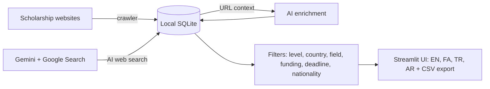

<div align="center">


<br />

# 🎓 Dara Scholarship Agent

**A free, open-source AI scholarship finder. Search, filter and compare scholarships worldwide by degree level, destination country, field of study, funding type and your own nationality.**

Powered by **Google Gemini** · Built with **Python & Streamlit** · UI in **English · فارسی · Türkçe · العربية**


[Features](#features) · [Quick start](#quick-start) · [Usage](#usage) · [Deploy online](#deploy) · [Troubleshooting](#troubleshooting) · [Changelog](CHANGELOG.md)

🌐 **English** · [فارسی](README.fa.md) · [Türkçe](README.tr.md)

</div>

---

<details open>
<summary><b>📑 Table of contents</b></summary>

- [📖 What is Dara Scholarship Agent?](#what-is)
- [✨ Features](#features)
- [🧠 How it works](#how-it-works)
- [🚀 Quick start](#quick-start)
  - [📦 Method 1: Direct download (no Git)](#install-direct)
  - [🌿 Method 2: With Git](#install-git)
  - [🖱️ One-click launcher: Run (Windows) / Run (Mac)](#launcher)
  - [🔑 Get a free Gemini API key](#api-key)
  - [⚙️ Configuration](#configuration)
- [🧭 Usage](#usage)
- [🌐 Supported sources](#sources)
- [🗂️ Project structure](#project-structure)
- [🖼️ Country images](#country-images)
- [☁️ Deploy online](#deploy)
- [🛠️ Troubleshooting](#troubleshooting)
- [⚠️ Responsible use & disclaimer](#responsible-use)
- [🗺️ Roadmap](#roadmap)
- [📋 Changelog](#changelog)
- [🤝 Contributing](#contributing)
- [📄 License](#license)
- [👤 Author & support](#author)

</details>

---

<a id="what-is"></a>

## 📖 What is Dara Scholarship Agent?

Finding a **fully funded scholarship** means opening dozens of websites, each with its own layout, deadlines and eligibility rules.
**Dara Scholarship Agent** is a **scholarship search engine and AI agent** that does the legwork for you:

1. it **imports hundreds of scholarships** from popular scholarship websites in seconds (no AI, no API key needed),
2. it can **search the live web with Gemini + Google Search** to discover scholarships those sites do not list,
3. it **reads each scholarship page with AI** to fill in funding, eligible nationalities, fields of study and language requirements,
4. and it lets you **filter everything instantly** by degree level, country, field, funding, deadline and **your nationality**, all stored locally on your computer.

It is built for students applying for **Bachelor, Master, PhD and Postdoc** scholarships abroad, and for study-abroad consultants who need a fast, repeatable way to build shortlists.

<a id="features"></a>

## ✨ Features

- 🎨 **Modern dashboard UI**: hero header, sidebar navigation, live statistics, expandable scholarship cards, and a **landmark illustration for every destination country** (Eiffel Tower for France, Big Ben for the UK, Brandenburg Gate for Germany, and 35+ more).
- 🌍 **Scholarships by education level**: separate tabs for Bachelor, Master, PhD, Postdoc and Other.
- 🔎 **Powerful filters**: country, field or keyword, funding type (Full / Partial / Tuition only), hide expired deadlines, and **eligibility by nationality** (choose any country, or "Any").
- 📚 **Fast website import (no AI, no key)**: Scholars4Dev, ScholarshipTab, ScholarshipSet, and country sites for Germany, the UK, Canada, the USA and Australia. Paste any compatible category URL to add more.
- 🤖 **AI web search**: Gemini + Google Search grounding. Leave *Destination countries* empty to search **all countries**; a deep-search mode runs one pass per world region.
- ✨ **AI enrichment**: Gemini reads each scholarship page (URL context) and fills funding, amount, eligible nationalities, fields and language requirements.
- 🗣️ **Four interface languages** with full **RTL support** (Persian and Arabic) and the *IRANSansX* font. Summaries are written in your chosen language, and your choice survives a page refresh.
- 💾 **Local-first**: results are saved in a local SQLite database. Filtering is instant and costs no API calls.
- ⬇️ **Export to CSV** for Excel and Google Sheets.
- 🛡️ **Reliable by design**: automatic retries for overloaded models (503), fast fallback on quota errors (429), and a configurable fallback model.
- 🔁 **Smart merging**: the same scholarship found on several websites or by the AI search appears only once. Importing again adds new scholarships and refreshes changed deadlines without erasing data filled in by AI; new arrivals carry a **NEW** badge.
- 🔐 **Private and remembered**: your API key stays on your machine. The sidebar saves it to your local `.env` (never committed to Git) so you do not retype it after a refresh; language, nationality and model are remembered too.

<!--
## 🖼️ Screenshots

| English | فارسی (RTL) |
|---|---|
|  |  |
-->

<a id="how-it-works"></a>

## 🧠 How it works



<a id="quick-start"></a>

## 🚀 Quick start

**Requirements:** Python 3.10 to 3.14 (3.12 or 3.13 recommended) ([python.org](https://www.python.org/downloads/); on Windows tick **Add Python to PATH** during setup) and a free Gemini API key (only needed for AI features). Very new versions such as 3.15 are not supported yet (some dependencies have no pre-built packages for them). Pick one of the two installation methods:

<a id="install-direct"></a>

### 📦 Method 1: Direct download (no Git needed)

1. Open the repository page on GitHub, click the green **Code** button, then **Download ZIP**.
2. Extract the ZIP anywhere (for example `Documents/scholarship-agent`).
3. Start the app:
   - **Windows:** double-click **`Run (Windows).bat`**.
   - **macOS / Linux:** open a terminal in the folder and run `bash "Run (Mac).sh"`.

   The first launch creates a virtual environment, installs the dependencies, creates your `.env` file and opens the app at **http://localhost:8501**. Later launches take a few seconds.
4. Add your Gemini API key in the app (**Settings** in the sidebar) or in `.env`.

> To update later, download the new ZIP and copy its files over the old folder. Keep your `.env` and `scholarships.db`.

<a id="install-git"></a>

### 🌿 Method 2: With Git (best for updates and contributors)

```bash
git clone https://github.com/idanieldara/scholarship-agent.git
cd scholarship-agent
```

Then start it with `Run (Windows).bat` (Windows) or `bash "Run (Mac).sh"` (macOS / Linux), or manually:

```bash
python -m venv venv
venv\Scripts\activate            # Windows  |  macOS / Linux: source venv/bin/activate
pip install -r requirements.txt
copy .env.example .env           # Windows  |  macOS / Linux: cp .env.example .env
streamlit run app.py
```

Update any time with `git pull`. The launch scripts reinstall changed dependencies automatically; when starting manually, run `pip install -r requirements.txt` again.

> **Streamlit asks for an email on the first run?** Just press **Enter**. `Run (Windows).bat` and `Run (Mac).sh` skip this prompt automatically. Always run the app from the project folder.

<a id="launcher"></a>

### 🖱️ Using the one-click launcher (`Run (Windows).bat` / `Run (Mac).sh`)

`Run (Windows).bat` (Windows) and `Run (Mac).sh` (macOS / Linux) start the app without typing any commands. On every launch they:

1. create the virtual environment `venv` if it does not exist (first run only),
2. check that all dependencies are installed and up to date,
3. create `.env` from `.env.example` if it is missing,
4. skip Streamlit's first-run email prompt,
5. run `streamlit run app.py`, which opens the app at **http://localhost:8501**.

**On Windows**

1. Make sure Python 3.10 to 3.14 (3.12 or 3.13 recommended) is installed (tick **Add Python to PATH** during setup).
2. Open the project folder and **double-click `Run (Windows).bat`**.
3. A black Command Prompt window opens. The first launch takes a few minutes while packages install; later launches take a few seconds.
4. When the app is ready your browser opens. If it does not, open **http://localhost:8501** yourself.

**On macOS / Linux:** open a terminal in the project folder and run `bash "Run (Mac).sh"`.

> **Good to know**
> - Keep the black window open while you use the app. Closing it (or pressing `Ctrl + C`) stops the app.
> - If you see *No supported Python found*, install Python 3.12 or 3.13 and tick **Add Python to PATH**.
> - Add your Gemini API key in the app (**Settings** in the sidebar) or in `.env` (`GEMINI_API_KEY=...`).
> - Prefer the terminal? The manual commands in Method 2 work exactly the same.

<a id="api-key"></a>

### 🔑 Get a free Gemini API key

1. Go to <https://aistudio.google.com/api-keys>.
2. Sign in with your Google account (`@gmail.com`). If you do not have one, you will be asked to create one.
3. Click **Create API key**.
4. Enter a name for the key and click **Create key**.
5. Click the key's name under the **Key** column, copy the key, and paste it into `.env` (`GEMINI_API_KEY=...`) or into the sidebar field of the app.

> The website import tab works **without** any API key.
>
> In the app, the **Get a free API key ↗** button under the key field opens the page above. With **Remember the key on this computer** ticked (the default) the key is saved to the local `.env`, so you do not have to type it again after a refresh or restart. The key is only written to disk when the app is opened via `localhost`; on a server it stays in the browser session.

<a id="configuration"></a>

### ⚙️ Configuration

| Variable | Default | Description |
|---|---|---|
| `GEMINI_API_KEY` | none | Your Google AI Studio key (or type it in the sidebar). |
| `GEMINI_MODEL` | `gemini-2.5-flash` | Main model. Can also be changed in the sidebar. |
| `GEMINI_FALLBACK_MODEL` | `gemini-2.5-flash-lite` | Used automatically when the main model is overloaded or out of quota. |
| `DARA_SAVE_KEY` | automatic | `1` always lets the sidebar save the key to `.env`, `0` never does. By default saving is allowed only when the app is opened via `localhost` (never on a public server). |

<a id="usage"></a>

## 🧭 Usage

1. Open **Settings** in the sidebar to choose your language, nationality, Gemini model and API key (pick *Any* nationality to see everything). Use the sidebar menu to switch between **Search scholarships** and **Saved results**. Your key, language, nationality and model are remembered between sessions.
2. **Collect scholarships**
   - *Import from websites*: select sources, set max pages, click **Import**. Run it again whenever you like: new scholarships are added, changed deadlines are refreshed and duplicates are merged.
   - *AI web search*: choose level, countries (empty = all), field and funding, then click **Find scholarships with AI**. Scholarships you already saved are skipped, so you get fresh results, and anything found on several sites is merged into one entry.
3. **Browse & filter**: use the level tabs and filters. Unknown eligibility rules are kept so you do not miss opportunities.
4. **Enrich with AI** (optional): let Gemini read the pages of results that lack funding or nationality info.
5. **Export CSV** and verify every deadline on the official page before applying.

<a id="sources"></a>

## 🌐 Supported sources

| Source | Content |
|---|---|
| Scholars4Dev | International scholarships (all levels) |
| ScholarshipTab | Masters, PhD, MBA, Undergraduate, Postgraduate, Fellowship, Fully funded |
| ScholarshipSet (Africa) | Masters, PhD, Undergraduate |
| GermanyScholarships · UKScholarships · ScholarshipCA · UScholarships · ScholarshipAU | Country-specific scholarships |
| Custom URL | Any category page with a compatible layout |
| Gemini + Google Search | Anything else on the open web |

> Some websites may refuse automated access (HTTP 403). The app skips them with a clear message; use the AI search tab instead.

<a id="project-structure"></a>

## 🗂️ Project structure

```text
dara-scholarship-agent/
├── Run (Windows).bat / Run (Mac).sh    # one-click launcher (Windows / macOS-Linux)
├── app.py              # Streamlit UI, filters, language and RTL handling
├── agent.py            # Gemini agent: web search, enrichment, retries and fallback
├── sources.py          # Website crawlers (no AI) and date/level parsing
├── db.py               # Local SQLite storage, duplicate merging and filtering helpers
├── storage.py          # saves settings (settings.json) and the API key (.env) locally
├── i18n.py             # EN / FA / TR / AR translations
├── countries.py        # country name -> landmark thumbnail (SVG or your own photo)
├── assets/countries/   # landmark illustrations (de.svg, fr.svg, ...) + optional photos
├── tools/make_country_art.py  # regenerates the SVG illustrations
├── static/             # IRANSansX fonts used for Persian and Arabic
├── docs/screenshots/   # README images
├── requirements.txt
├── .env.example
├── CHANGELOG.md        # version history
└── LICENSE
```

<a id="country-images"></a>

## 🖼️ Country images

Every scholarship card shows a thumbnail of a famous landmark of its destination country (Eiffel Tower, Big Ben, Brandenburg Gate, Sydney Opera House, Mount Fuji, and more). Scholarships without a specific country get a globe.

To use **your own photos** instead of the bundled illustrations, drop a file named after the two-letter country code into `assets/countries/`:

```text
assets/countries/de.jpg     # Germany
assets/countries/gb.webp    # United Kingdom
assets/countries/us.png     # United States
```

Supported formats: `.jpg`, `.png`, `.webp` (a photo always wins over the `.svg`). Only use images you own or that are licensed for reuse. Restart the app to see the change. To add a new country, add its names to `NAMES` in `countries.py` and put `<code>.jpg` (or `.svg`) in the same folder.

<a id="deploy"></a>

## ☁️ Deploy online

GitHub stores your code; it does not run Streamlit apps. To make the app available online:

- **Streamlit Community Cloud (free):** push the repo to GitHub, open <share.streamlit.io>, click **Create app**, choose the repo, branch `main` and file `app.py`, then **Deploy**.
  Do **not** add your own API key to *Secrets* on a public app (anyone could spend your quota); leave it empty so each visitor enters their own key in the sidebar. Saved results reset when the app restarts. On a server the sidebar never writes keys to disk (see `DARA_SAVE_KEY`).
- **Your own server (VPS):** `pip install -r requirements.txt`, then `streamlit run app.py --server.port 8501 --server.address 0.0.0.0` behind Nginx/Caddy with HTTPS.

<a id="troubleshooting"></a>

## 🛠️ Troubleshooting

| Problem | Meaning and fix |
|---|---|
| `429` / `RESOURCE_EXHAUSTED` | Quota or rate limit reached. The app switches to the fallback model; reduce passes (turn off *Deep search*), wait a minute, or enable billing. |
| `503 UNAVAILABLE` | Model overloaded. The app retries automatically (3, 6, 12, 24 s) and then uses the fallback model. |
| `403 Forbidden` for a website | That site blocks automated access. Use another source or the AI search tab. |
| `ERROR: Could not open requirements file ... 'requirements.txt'` | The launcher is not next to the project files (for example it was run from inside the ZIP, or moved out of the folder). Extract the **whole** ZIP (right-click, *Extract All*) and run the launcher from inside the extracted project folder. Also check that `requirements.txt` exists in your repository. The newer launcher shows a clear message for this. |
| `Microsoft Visual C++ 14.0 or greater is required` / `Failed building wheel` (pyarrow, pyyaml) | Your Python is too new (for example 3.15) and some packages have no pre-built version. Install Python 3.12 or 3.13, delete the `venv` folder and run `Run (Windows).bat` again; the launcher picks a supported Python automatically. |
| `'streamlit' is not recognized` | The dependencies failed to install. Fix the error shown above it (see the rows above), then run the launcher again. |
| The API key is not remembered | Saving works only when the app is opened on this computer (`localhost`) and *Remember the key on this computer* is ticked. You can also put the key in `.env` yourself, or set `DARA_SAVE_KEY=1`. |
| The same scholarship appears twice | Duplicates are merged automatically on every import, AI search and app start. If two entries still show up, their titles differ a lot, so they are treated as different scholarships. |
| Persian font not applied | Keep `static/Sans-Regular.woff2` and `static/Sans-Bold.woff2` next to `app.py` and restart the app. |
| Few AI results | Gemini is not a crawler. Use website import for volume, and AI search for discovery. |

<a id="responsible-use"></a>

## ⚠️ Responsible use & disclaimer

- Scholarship information can be incomplete or outdated, and AI can make mistakes. **Always verify deadlines, eligibility and requirements on the official page.**
- The crawlers are intended for light, personal use. Respect each website's terms of service and `robots.txt`, and keep the page limits modest.
- The font files in `static/` are *IRANSansX*; check its license before redistributing a fork. If the files are missing the app falls back to Tahoma.

<a id="roadmap"></a>

## 🗺️ Roadmap

- [ ] More scholarship sources and an official-site connector for DAAD, Chevening, Fulbright
- [ ] Deadline reminders by email / WhatsApp / Telegram
- [ ] Saved searches and favorites
- [ ] Docker image and one-click deploy
<a id="changelog"></a>

## 📋 Changelog

All notable changes are documented in [CHANGELOG.md](CHANGELOG.md).
The latest release is **v0.6.0**: the API key and settings are remembered, duplicate scholarships are merged, and importing again refreshes the list.
<a id="contributing"></a>

## 🤝 Contributing

Issues and pull requests are welcome. Please open an issue first for larger changes, keep code formatted, and add translations for new UI text to all four languages in `i18n.py`.

<a id="license"></a>

## 📄 License

Released under the [MIT License](LICENSE).

<a id="author"></a>

## 👤 Author & support

Built by **Daniel Dara**, web developer and AI automation builder.

- 🌐 Website: [danieldara.com](https://danieldara.com)

If this project helps you, please give it a ⭐ on GitHub.

<details>
<summary>Topics</summary>

scholarship finder · scholarship search engine · fully funded scholarships · study abroad · master's scholarships · PhD scholarships · AI agent · Google Gemini API · Streamlit app · Python web scraper · RTL Persian Arabic Turkish UI

</details>
