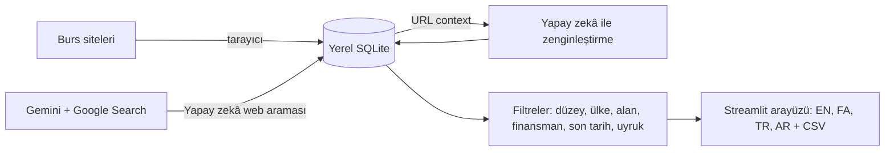

<div align="center">


<br />

# 🎓 Dara Burs Ajanı (Dara Scholarship Agent)

**Ücretsiz ve açık kaynaklı yapay zekâ burs bulucu. Dünyadaki bursları eğitim düzeyine, hedef ülkeye, alana, finansman türüne ve kendi uyruğunuza göre arayın, filtreleyin ve karşılaştırın.**

**Google Gemini** ile güçlendirildi · **Python & Streamlit** ile geliştirildi · Arayüz: **English · فارسی · Türkçe · العربية**


[Özellikler](#features) · [Hızlı başlangıç](#quick-start) · [Kullanım](#usage) · [Çevrimiçi yayın](#deploy) · [Sorun giderme](#troubleshooting)

🌐 [English](README.md) · [فارسی](README.fa.md) · **Türkçe**

</div>

---

<details open>
<summary><b>📑 İçindekiler</b></summary>

- [📖 Dara Burs Ajanı nedir?](#what-is)
- [✨ Özellikler](#features)
- [🧠 Nasıl çalışır?](#how-it-works)
- [🚀 Hızlı başlangıç](#quick-start)
  - [🔑 Ücretsiz Gemini API anahtarı alma](#api-key)
  - [⚙️ Yapılandırma](#configuration)
- [🧭 Kullanım](#usage)
- [🌐 Desteklenen kaynaklar](#sources)
- [🗂️ Proje yapısı](#project-structure)
- [🖼️ Ülke görselleri](#country-images)
- [☁️ Çevrimiçi yayın](#deploy)
- [🛠️ Sorun giderme](#troubleshooting)
- [⚠️ Sorumlu kullanım ve uyarı](#responsible-use)
- [🗺️ Yol haritası](#roadmap)
- [🤝 Katkıda bulunma](#contributing)
- [📄 Lisans](#license)
- [👤 Geliştirici ve destek](#author)

</details>

---

<a id="what-is"></a>

## 📖 Dara Burs Ajanı nedir?

**Tam burslu** bir program bulmak, her biri farklı tasarıma, son tarihe ve koşula sahip onlarca siteyi açmak demektir.
**Dara Burs Ajanı**, bu işi sizin yerinize yapan bir **burs arama motoru ve yapay zekâ ajanıdır**:

1. popüler burs sitelerinden **yüzlerce bursu saniyeler içinde içe aktarır** (yapay zekâ ve API anahtarı gerekmez),
2. bu sitelerde olmayan bursları **Gemini + Google Search** ile web'de arar,
3. her burs sayfasını **yapay zekâ ile okuyarak** finansman, uygun uyruklar, alanlar ve dil şartlarını doldurur,
4. ve her şeyi **eğitim düzeyi, ülke, alan, finansman, son tarih ve kendi uyruğunuza** göre anında filtreler. Veriler bilgisayarınızda yerel olarak saklanır.

Yurt dışında **Lisans, Yüksek lisans, Doktora ve Doktora sonrası** bursu arayan öğrenciler ve hızlı, tekrarlanabilir kısa listeler hazırlamak isteyen eğitim danışmanları için tasarlandı.

<a id="features"></a>

## ✨ Özellikler

- 🎨 **Modern panel arayüzü**: hero başlık, kenar çubuğu menüsü, canlı istatistikler, açılır burs kartları ve **her hedef ülke için bir simge yapı illüstrasyonu** (Fransa için Eyfel Kulesi, Birleşik Krallık için Big Ben, Almanya için Brandenburg Kapısı ve 35'ten fazlası).
- 🌍 **Eğitim düzeyine göre burslar**: Lisans, Yüksek lisans, Doktora, Doktora sonrası ve Diğer için ayrı sekmeler.
- 🔎 **Güçlü filtreler**: ülke, alan veya anahtar kelime, finansman türü (Tam / Kısmi / Yalnızca harç), süresi dolanları gizleme ve **uyruğa göre uygunluk** (istediğiniz ülkeyi veya "Herhangi biri"ni seçin).
- 📚 **Hızlı site içe aktarma (yapay zekâsız, anahtarsız)**: Scholars4Dev, ScholarshipTab, ScholarshipSet ile Almanya, Birleşik Krallık, Kanada, ABD ve Avustralya ülke siteleri. Uyumlu herhangi bir kategori URL'sini ekleyebilirsiniz.
- 🤖 **Yapay zekâ ile web araması**: Gemini + Google Search. *Hedef ülkeler* boşsa **tüm ülkelerde** aranır; derin arama modu her dünya bölgesi için bir tur çalıştırır.
- ✨ **Yapay zekâ ile zenginleştirme**: Gemini her burs sayfasını okur (URL context) ve finansman, tutar, uygun uyruklar, alanlar ve dil şartlarını doldurur.
- 🗣️ **Dört arayüz dili**: tam **RTL** desteği (Farsça ve Arapça) ve *Sans* yazı tipi. Özetler seçtiğiniz dilde yazılır ve seçiminiz sayfa yenilenince korunur.
- 💾 **Yerel öncelikli**: sonuçlar yerel SQLite veritabanına kaydedilir. Filtreleme anlıktır ve API çağrısı gerektirmez.
- ⬇️ Excel ve Google Sheets için **CSV dışa aktarma**.
- 🛡️ **Güvenilir tasarım**: aşırı yüklenen modeller için otomatik yeniden deneme (503), kota hatalarında (429) hızlı geçiş ve yapılandırılabilir yedek model.
- 🔐 **Gizli**: API anahtarınız yalnızca sizin bilgisayarınızda kalır (`.env` veya kenar çubuğu alanı).

<a id="how-it-works"></a>

## 🧠 Nasıl çalışır?



<a id="quick-start"></a>

## 🚀 Hızlı başlangıç

**Gereksinimler:** Python 3.10 veya üzeri ve ücretsiz bir Gemini API anahtarı (yalnızca yapay zekâ özellikleri için).

```bash
# 1. kodu indirin
git clone https://github.com/idanieldara/scholarship-agent.git
cd dara-scholarship-agent

# 2. sanal ortam oluşturun
python -m venv venv
venv\Scripts\activate            # Windows
# source venv/bin/activate       # macOS / Linux

# 3. bağımlılıkları yükleyin
pip install -r requirements.txt

# 4. API anahtarınızı ekleyin
copy .env.example .env           # Windows
# cp .env.example .env           # macOS / Linux

# 5. çalıştırın
streamlit run app.py
```

Uygulama **http://localhost:8501** adresinde açılır. Proje klasöründen çalıştırın.

<a id="api-key"></a>

### 🔑 Ücretsiz Gemini API anahtarı alma

1. <https://aistudio.google.com/api-keys> adresine gidin.
2. Google hesabınızla (`@gmail.com`) giriş yapın. Hesabınız yoksa bir hesap oluşturmanız istenir.
3. **API anahtarı oluştur** (**Create API key**) seçeneğine tıklayın.
4. Anahtar için bir ad girin ve **Create key**'e tıklayın.
5. **Key** sütununun altındaki ada tıklayın, anahtarı kopyalayın ve `.env` dosyasına (`GEMINI_API_KEY=...`) veya uygulamanın kenar çubuğundaki alana yapıştırın.

> Site içe aktarma sekmesi **API anahtarı olmadan** çalışır.

<a id="configuration"></a>

### ⚙️ Yapılandırma

| Değişken | Varsayılan | Açıklama |
|---|---|---|
| `GEMINI_API_KEY` | yok | Google AI Studio anahtarınız (veya kenar çubuğuna yazın). |
| `GEMINI_MODEL` | `gemini-2.5-flash` | Ana model. Kenar çubuğundan da değiştirilebilir. |
| `GEMINI_FALLBACK_MODEL` | `gemini-2.5-flash-lite` | Ana model aşırı yüklenince veya kota dolunca otomatik kullanılır. |

<a id="usage"></a>

## 🧭 Kullanım

1. Kenar çubuğunda **Ayarlar**'ı açıp dilinizi, uyruğunuzu, Gemini modelinizi ve API anahtarınızı seçin (her şeyi görmek için *Herhangi biri* uyruğunu seçin). Kenar çubuğu menüsüyle **Burs ara** ve **Kayıtlı sonuçlar** arasında geçiş yapın.
2. **Bursları toplayın**
   - *Web sitelerinden içe aktar*: kaynakları seçin, en fazla sayfa sayısını belirleyin ve **İçe aktar**'a tıklayın.
   - *Yapay zekâ web araması*: düzey, ülkeler (boş = hepsi), alan ve finansmanı seçip **Yapay zekâ ile burs ara**'ya tıklayın.
3. **Göz atın ve filtreleyin**: düzey sekmelerini ve filtreleri kullanın. Uygunluğu bilinmeyen kayıtlar, fırsat kaçırmamanız için tutulur.
4. **Yapay zekâ ile zenginleştirin** (isteğe bağlı): Gemini'nin finansman veya uyruk bilgisi eksik sonuçların sayfalarını okumasına izin verin.
5. **CSV olarak dışa aktarın** ve başvurmadan önce her son tarihi resmî sayfada doğrulayın.

<a id="sources"></a>

## 🌐 Desteklenen kaynaklar

| Kaynak | İçerik |
|---|---|
| Scholars4Dev | Uluslararası burslar (tüm düzeyler) |
| ScholarshipTab | Yüksek lisans, Doktora, MBA, Lisans, Lisansüstü, Fellowship, Tam burslu |
| ScholarshipSet (Afrika) | Yüksek lisans, Doktora, Lisans |
| GermanyScholarships · UKScholarships · ScholarshipCA · UScholarships · ScholarshipAU | Ülkeye özel burslar |
| Özel URL | Uyumlu düzene sahip herhangi bir kategori sayfası |
| Gemini + Google Search | Açık web'deki diğer her şey |

> Bazı siteler otomatik erişimi reddedebilir (HTTP 403). Uygulama bunları açık bir mesajla atlar; bunun yerine yapay zekâ arama sekmesini kullanın.

<a id="project-structure"></a>

## 🗂️ Proje yapısı

```text
dara-scholarship-agent/
├── app.py              # Streamlit arayüzü, filtreler, dil ve RTL yönetimi
├── agent.py            # Gemini ajanı: web araması, zenginleştirme, yeniden deneme ve yedek model
├── sources.py          # Site tarayıcıları (yapay zekâsız) ve tarih/düzey ayrıştırma
├── db.py               # Yerel SQLite depolama ve filtre yardımcıları
├── i18n.py             # EN / FA / TR / AR çevirileri
├── countries.py        # ülke adı -> simge yapı görseli (SVG veya kendi fotoğrafınız)
├── assets/countries/   # simge yapı illüstrasyonları (de.svg, fr.svg, ...) + isteğe bağlı fotoğraflar
├── tools/make_country_art.py  # SVG illüstrasyonlarını yeniden üretir
├── static/             # Farsça ve Arapça için Sans yazı tipleri
├── assets/screenshots/   # README görselleri
├── requirements.txt
├── .env.example
└── LICENSE
```

<a id="country-images"></a>

## 🖼️ Ülke görselleri

Her burs kartı, hedef ülkenin ünlü bir simge yapısının görselini gösterir (Eyfel Kulesi, Big Ben, Brandenburg Kapısı, Sidney Opera Binası, Fuji Dağı ve daha fazlası). Belirli bir ülkesi olmayan burslar dünya küresi alır.

Paketle gelen illüstrasyonlar yerine **kendi fotoğraflarınızı** kullanmak için iki harfli ülke koduyla adlandırılmış dosyayı `assets/countries/` klasörüne bırakın:

```text
assets/countries/de.jpg     # Almanya
assets/countries/gb.webp    # Birleşik Krallık
assets/countries/us.png     # ABD
```

Desteklenen biçimler: `.jpg`, `.png`, `.webp` (fotoğraf her zaman `.svg` dosyasına üstün gelir). Yalnızca size ait veya yeniden kullanım lisanslı görselleri kullanın. Değişikliği görmek için uygulamayı yeniden başlatın. Yeni bir ülke eklemek için adlarını `countries.py` içindeki `NAMES` sözlüğüne ekleyin ve aynı klasöre `<kod>.jpg` (veya `.svg`) koyun.

<a id="deploy"></a>

## ☁️ Çevrimiçi yayın

GitHub kodunuzu saklar; Streamlit uygulamalarını çalıştırmaz. Uygulamayı çevrimiçi sunmak için:

- **Streamlit Community Cloud (ücretsiz):** depoyu GitHub'a gönderin, <share.streamlit.io> adresini açın, **Create app**'e tıklayın, depoyu, `main` dalını ve `app.py` dosyasını seçip **Deploy** edin.
  Herkese açık bir uygulamada kendi API anahtarınızı *Secrets* içine **koymayın** (herkes kotanızı harcayabilir); boş bırakın ki her ziyaretçi kendi anahtarını kenar çubuğuna girsin. Uygulama yeniden başlayınca kayıtlı sonuçlar sıfırlanır.
- **Kendi sunucunuz (VPS):** `pip install -r requirements.txt`, ardından Nginx/Caddy arkasında HTTPS ile `streamlit run app.py --server.port 8501 --server.address 0.0.0.0` çalıştırın.

<a id="troubleshooting"></a>

## 🛠️ Sorun giderme

| Sorun | Anlamı ve çözüm |
|---|---|
| `429` / `RESOURCE_EXHAUSTED` | Kota veya hız sınırı doldu. Uygulama yedek modele geçer; turları azaltın (*Derin arama*'yı kapatın), bir dakika bekleyin veya faturalandırmayı etkinleştirin. |
| `503 UNAVAILABLE` | Model aşırı yüklü. Uygulama otomatik yeniden dener (3, 6, 12, 24 sn) ve ardından yedek modeli kullanır. |
| Bir site için `403 Forbidden` | O site otomatik erişimi engelliyor. Başka bir kaynak veya yapay zekâ arama sekmesini kullanın. |
| Farsça yazı tipi uygulanmıyor | `static/Sans-Regular.woff2` ve `static/Sans-Bold.woff2` dosyalarını `app.py` ile aynı yerde tutun ve uygulamayı yeniden başlatın. |
| Yapay zekâ az sonuç veriyor | Gemini bir tarayıcı değildir. Hacim için site içe aktarmayı, keşif için yapay zekâ aramasını kullanın. |

<a id="responsible-use"></a>

## ⚠️ Sorumlu kullanım ve uyarı

- Burs bilgileri eksik veya güncel olmayabilir ve yapay zekâ hata yapabilir. **Son tarihleri, uygunluğu ve şartları her zaman resmî sayfada doğrulayın.**
- Tarayıcılar hafif ve kişisel kullanım içindir. Her sitenin kullanım koşullarına ve `robots.txt` dosyasına saygı gösterin, sayfa sınırlarını makul tutun.
- `static/` içindeki yazı tipi dosyaları *Sans*'tir; bir fork'u yeniden dağıtmadan önce lisansını kontrol edin. Dosyalar yoksa uygulama Tahoma'ya döner.

<a id="roadmap"></a>

## 🗺️ Yol haritası

- [ ] Daha fazla burs kaynağı; DAAD, Chevening, Fulbright için resmî site bağlayıcıları
- [ ] E-posta / WhatsApp / Telegram ile son tarih hatırlatmaları
- [ ] Kayıtlı aramalar ve favoriler
- [ ] Docker imajı ve tek tıkla yayın

<a id="contributing"></a>

## 🤝 Katkıda bulunma

Issue ve pull request'ler memnuniyetle karşılanır. Büyük değişiklikler için önce bir issue açın, kodu düzenli tutun ve arayüzdeki yeni metinlerin çevirilerini `i18n.py` içinde dört dile de ekleyin.

<a id="license"></a>

## 📄 Lisans

[MIT Lisansı](LICENSE) ile yayımlanmıştır.

<a id="author"></a>

## 👤 Geliştirici ve destek

**Daniel Dara** tarafından geliştirildi; web geliştirici ve yapay zekâ otomasyonu üreticisi.

- 🌐 Web sitesi: [danieldara.com](https://danieldara.com)

Bu proje işinize yaradıysa GitHub'da bir ⭐ verin.
